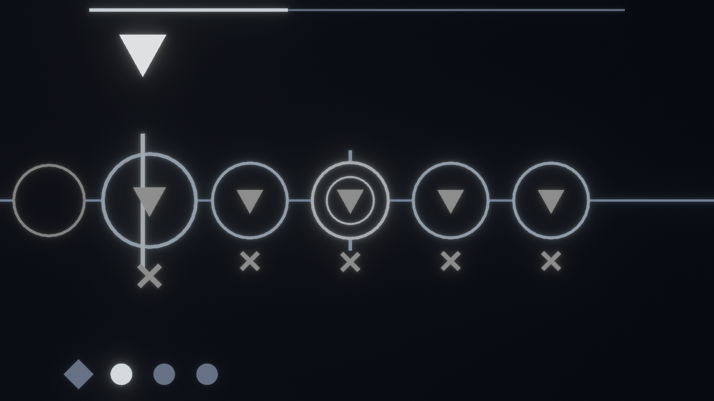
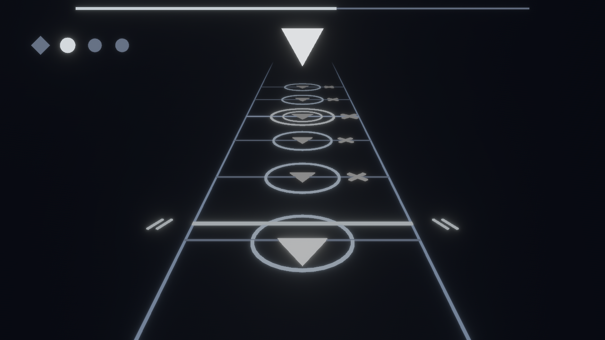
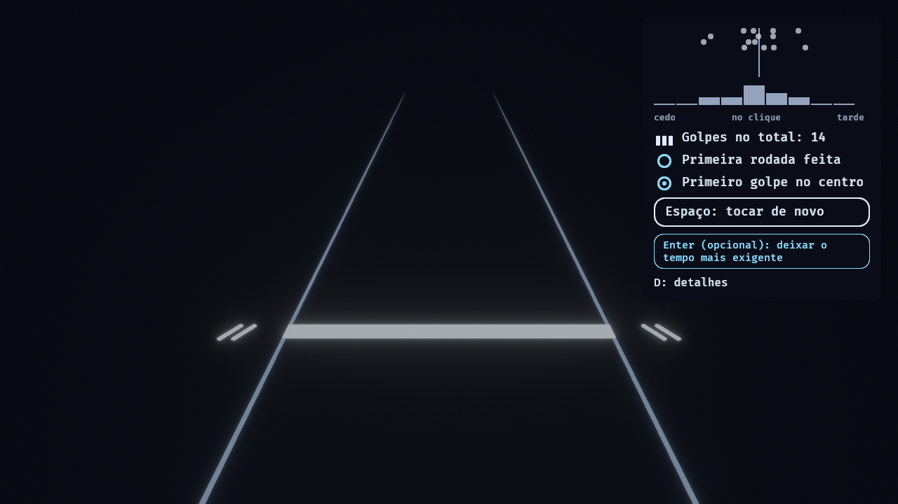
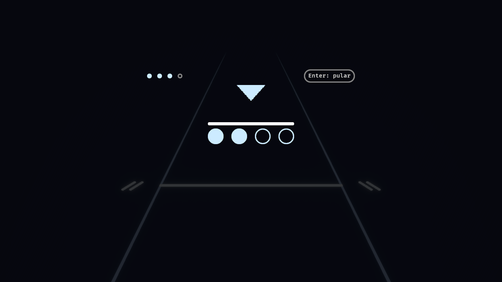

# Guitarness

_Antes chamado Tônica._

Jogo para aprender violão e guitarra no PC, tocando o instrumento de verdade. O microfone ouve, e o jogo julga os golpes. O núcleo é em Rust, e a parte visual usa o motor Bevy.

O público principal é o adulto iniciante, ansioso ou com TDAH. Por isso o jogo segue estas regras:

- Não há punição nem tela de falha.
- Não há vermelho para erro.
- Os números só sobem.
- O jogo só afirma o que mediu. Quando não ouve, mostra "não ouvi" e deixa você contestar.

## Estado atual

O projeto está no começo e **nada foi testado com microfone real ainda**.

- **Fatia "Pulso":** o treino de tempo já é jogável em um backend de áudio falso (relógio virtual, sem placa de som). A sessão grava uma fita, e o replay da fita é exato nos bancos de teste.
- **Juiz de acordes:** existe só em bancada sintética. Os portões de precisão continuam trancados (`Locked`) até haver gravações reais. Os portões de ataque, tempo e tendência estão em `Provisional`, com evidência só sintética. Nenhum portão está aberto (`Open`).
- **Detector de ataque e calibração:** medidos apenas em sinal sintético. Os números estão nos [relatórios](docs/relatorios/).
- **Próximo passo:** a primeira sessão com microfone e caixa de som reais, descrita no [roteiro da primeira sessão](docs/roteiro-primeira-sessao.md).

## Capturas de tela

Estas imagens saem do modo `--screenshot` do jogo, que roda sem janela. Mostram o estado atual do protótipo, e ele ainda vai mudar.

| Pulso em 2D | Pulso em 3D |
|---|---|
|  |  |
| **Resumo da rodada** | **Passagem de som** |
|  |  |

## Requisitos

- Rust na versão fixada em [`rust-toolchain.toml`](rust-toolchain.toml) (o `rustup` instala sozinho).
- macOS ou Windows. No Windows, as Build Tools do MSVC (carga de trabalho "Desktop C++" e Windows SDK).
- Para jogar ao vivo: microfone e caixa de som. O jogo mede a latência do sistema ouvindo o próprio alto-falante. Fones e Bluetooth não fecham esse laço, e o resultado fica mais pobre.

## Como compilar e testar

O repositório tem dois workspaces Cargo. O principal fica na raiz. O jogo (Bevy) é um workspace separado em `crates/guitarness-game`, com lockfile e pasta `target` próprios.

```
# núcleo, DSP, sessão e CLI (workspace da raiz)
cargo test --release

# jogo (workspace separado)
cd crates/guitarness-game
cargo test --release
```

O jogo também roda sem janela para gerar capturas de tela:

```
cd crates/guitarness-game
cargo run --release -- --screenshot ../../saida-capturas
```

Outros comandos úteis:

```
cargo bench -p guitarness-dsp --bench frame     # custo por quadro do detector
cargo run --release -p guitarness-cli -- analyze legacy/web-demo/test/golden/B-soando.wav
```

## Linha de comando `guitarness`

O binário `guitarness` (crate `guitarness-cli`) reúne as ferramentas que não precisam do jogo. Todos os subcomandos, menos `analyze`, aceitam `--help`. Com `--fake`, vários deles rodam num backend falso, sem hardware.

| Comando | O que faz |
|---|---|
| `guitarness analyze arquivo.wav` | Roda o pipeline de detecção real num WAV e lista os eventos. |
| `guitarness audio devices` / `probe` / `soak` | Lista dispositivos, sonda entrada e saída e testa estabilidade. Só toca som com `--beep`. |
| `guitarness audio record PASTA --take ROTULO` | Grava uma fita de tomada de referência com rótulo. |
| `guitarness calibrate` | Passagem de som: mede a latência do sistema (`L_rt`) e o viés do jogador e grava um perfil. |
| `guitarness tune` | Afinador de linha de comando. Só escuta, não toca nada. |
| `guitarness replay FITA...` | Reexecuta fitas no juiz atual. Mostra diferenças, contestações e a tabela de confusão. |
| `guitarness verify FITA...` | Mostra o que a testemunha de acordes ouve nas fitas. Só relata, não muda veredito. |

O passo a passo com microfone real está no [roteiro da primeira sessão](docs/roteiro-primeira-sessao.md).

## Estrutura do repositório

| Caminho | O que é |
|---|---|
| `crates/guitarness-dsp` | Detector de altura e de ataque em tempo real, sem alocação no caminho por quadro. |
| `crates/guitarness-theory` | Notas, intervalos (notação brasileira), escalas, acordes e braço. |
| `crates/guitarness-core` | Regras do jogo determinísticas: gráfico, juiz do Pulso, portões, contrato por evento, estatísticas e relatório. Sem áudio, sem arquivos. |
| `crates/guitarness-sim` | Violão virtual: cordas, rasgueados, salas e microfones sintéticos, com verdade de referência para as bancadas. |
| `crates/guitarness-audio` | Áudio ao vivo: abstração de backend (real com `cpal` e falso com relógio virtual), mixer, relógios, captura e calibração. |
| `crates/guitarness-session` | Cola entre o motor de áudio e as regras: sessão, fita, replay e bancada falsa. |
| `crates/guitarness-cli` | O binário `guitarness`. |
| `crates/guitarness-learn` | Modelo do aluno: evidência, domínio, placar exibido (só sobe), agenda de revisão oculta, escolha do próximo bloco, treinador por regras e armazenamento. |
| `crates/guitarness-verify` | Verificador de acordes: conjuntos de confusão fechados, testemunha DSP, regra de decisão e bancada sintética. Os portões de acorde seguem trancados. |
| `crates/guitarness-game` | O jogo em Bevy (workspace separado), com fonte e capturas de tela. |
| `docs/` | Documentação (veja abaixo). |
| `legacy/web-demo` | Demo web original em JavaScript. É a referência dos testes `golden` do DSP. |
| `LICENSES/` | Textos de licença de terceiros. |

## Documentação

O [índice da documentação](docs/README.md) lista tudo. Para começar:

- [Visão geral da arquitetura](docs/arquitetura/visao-geral.md)
- [Design do jogo](docs/design/design-do-jogo.md) e seus adendos
- [Decisões de arquitetura (ADR)](docs/adr/)
- [Relatórios medidos](docs/relatorios/)
- [Pesquisa](docs/pesquisa/)
- [Roteiro da primeira sessão com microfone real](docs/roteiro-primeira-sessao.md)

## Licença

O código é distribuído sob a [licença MIT](LICENSE). Há quatro exceções, detalhadas em [THIRD_PARTY_NOTICES.md](THIRD_PARTY_NOTICES.md):

- A fonte Fira Mono do jogo usa a licença OFL 1.1 ([texto](LICENSES/FiraMono-OFL-1.1.txt)).
- A dependência `audio_thread_priority` (trazida pelo `cpal`) usa a licença MPL-2.0.
- A dependência `r-efi` oferece várias licenças, e vale a escolha MIT ou Apache-2.0.
- As imagens em `docs/arte/minimal` foram geradas por IA. A proveniência está descrita no [README da pasta](docs/arte/minimal/README.md).

## Contribuição

Contribuições são bem-vindas. Abra uma issue antes de mudanças grandes. Antes de enviar um pull request:

- Rode `cargo fmt --all --check` e `cargo clippy --workspace --all-targets -- -D warnings`.
- Rode `cargo test --release` na raiz (e em `crates/guitarness-game`, se mexer no jogo).
- Mantenha a documentação em português do Brasil.
- Não adicione gravações de áudio, tablaturas ou letras de músicas protegidas por direitos autorais.
